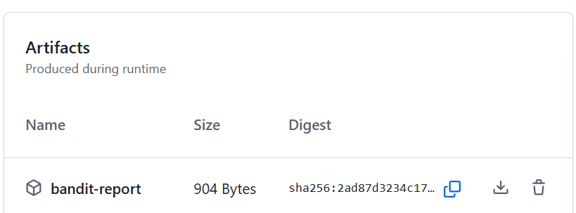
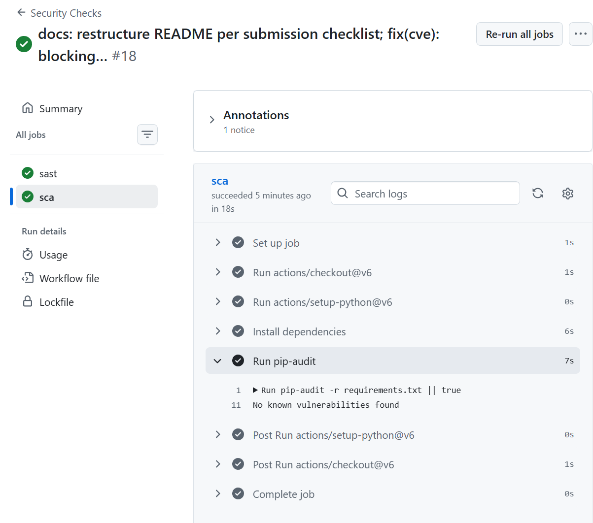
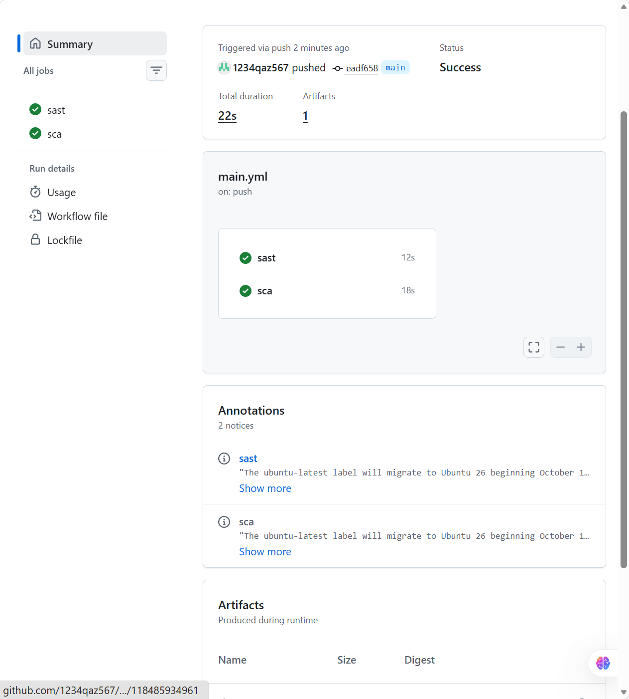
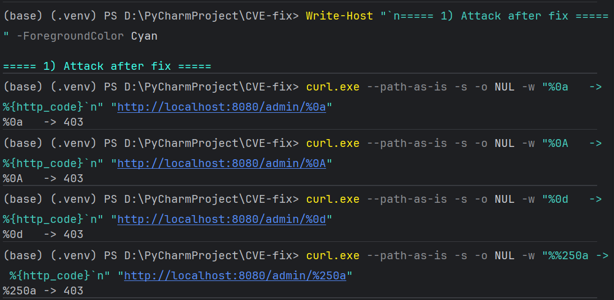
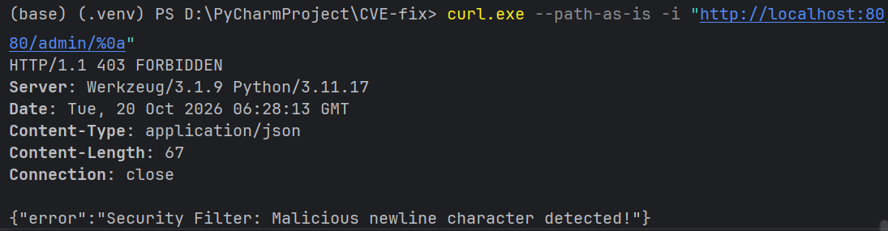
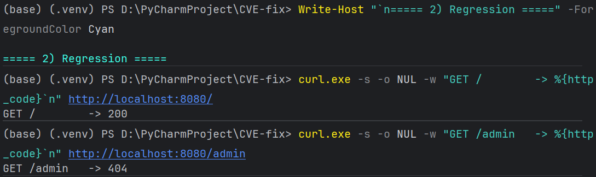

# Work 1: Secure REST API Development with CI/CD and Real CVE Vulnerability Analysis

- **Student Name**: Ruan Hongzhe
- **Student ID**: 422810
- **HDU Number**: 23320213
- **Repository**: <https://github.com/1234qaz567/secure-api-lab>

## 0. Purpose

To build a backend API hardened against the OWASP Top 10 categories of injection
and broken authentication, to automate its security verification in a CI/CD
pipeline, and to reproduce, analyse and remediate a real-world CVE inside a
containerised environment — covering the full lifecycle from design, through
detection, to a verified fix.

## 1. Submission Checklist

This README follows the structure required by the assignment. Every required
item maps to a section below.

| Required item | Section |
|---|---|
| Link to a public git repository | header above (`Repository`) |
| Description of the project and API (endpoints, how to call them) | §2 |
| Description of the security measures (SQLi, XSS, authentication) | §3 |
| Screenshots of SAST/SCA reports from the Actions section | §4.2 |
| Name of the vulnerability (CVE ID) and a brief description | §5.1 |
| Sequence of actions to reproduce the vulnerability | §5.2 |
| Root cause analysis | §5.3 |
| Description of the applied fix and why it is effective | §5.4 |
| Proof of vulnerability elimination | §5.5 |
| Link to the last successful pipeline run | §4.3 |
| Folder with the fixes | §7 (`CVE-fix/`) |

## 2. Project and API Description

A REST API built with **Python 3 / Flask**, storing data in **SQLite**. It
implements the security measures required by the assignment and is verified by a
GitHub Actions pipeline on every push and pull request.

### 2.1 Running the project locally

```bash
python -m venv .venv
.venv\Scripts\activate          # Windows;  source .venv/bin/activate on Linux/macOS
pip install -r requirements.txt

python init_db.py               # creates app.db and the demo user
python app.py                   # serves http://127.0.0.1:5000
```

Demo credentials: `alice` / `Password123!`. The JWT signing key is read from the
`JWT_SECRET_KEY` environment variable and falls back to a development-only value
when the variable is absent.

### 2.2 Endpoints

| # | Method | Path | Authentication | Description |
|---|--------|------|----------------|-------------|
| 1 | `POST` | `/auth/login` | none | Validates credentials with bcrypt and issues a JWT |
| 2 | `GET` | `/api/data` | JWT required | Returns the list of users |
| 3 | `POST` | `/api/notes` | JWT required | Custom endpoint: stores a text note |

### 2.3 How to call them

```bash
# 1) Login — returns {"token": "<JWT>"}; 401 on bad credentials
curl -s -X POST http://127.0.0.1:5000/auth/login \
     -H "Content-Type: application/json" \
     -d '{"username":"alice","password":"Password123!"}'

# 2) Protected data — 401 without a token, 200 with one
curl -i http://127.0.0.1:5000/api/data
curl -i http://127.0.0.1:5000/api/data -H "Authorization: Bearer <JWT>"

# 3) Create a note — 201 on success
curl -i -X POST http://127.0.0.1:5000/api/notes \
     -H "Authorization: Bearer <JWT>" \
     -H "Content-Type: application/json" \
     -d '{"content":"my note"}'
```

## 3. Detailed Description of the Implemented Security Measures

### 3.1 Protection against SQL Injection (SQLi)

Every database interaction uses a **parameterized query**; user input is never
interpolated into SQL text. Lookup by username:

```python
row = db.execute(
    "SELECT id, password_hash FROM users WHERE username = ?",
    (username,),
).fetchone()
```

and insertion of a note:

```python
db.execute("INSERT INTO notes (content) VALUES (?)", (safe_content,))
```

Because the driver transmits the value separately from the statement, a payload
such as `alice' OR '1'='1` is treated as a literal string and matches no row.
This was verified at runtime: the injection attempt returns `401` instead of a
token (§6.1, check 4).

### 3.2 Protection against Cross-Site Scripting (XSS)

All user-controlled data that is returned in a response or persisted is escaped
with `markupsafe.escape()`:

```python
safe_content = str(escape(content))
```

`escape()` converts `<`, `>`, `&`, `"` and `'` into HTML entities, so the payload
`<script>alert(1)</script>` is stored and returned as
`&lt;script&gt;alert(1)&lt;/script&gt;` and can never be interpreted as markup.
The `/api/data` response escapes the `username` field the same way, so data
entering through any path is neutralised at the boundary.

### 3.3 How Authentication Is Implemented

* **Password storage** — passwords are hashed with **bcrypt** (per-password
  random salt, deliberately slow) and never stored or compared in plaintext:

  ```python
  if row is None or not bcrypt.checkpw(password_bytes, row["password_hash"]):
      return jsonify({"msg": "Invalid credentials"}), 401
  ```

* **Token issuance** — a signed JWT is created only after a successful password
  check; the token identity is the numeric user id, and tokens expire after
  30 minutes (`JWT_ACCESS_TOKEN_EXPIRES`).
* **Token verification** — every protected route is guarded by the
  `@jwt_required()` middleware, which validates the signature, the algorithm and
  the expiry before the view function runs.
* **Failure behaviour** — a missing token yields `401`; a malformed or tampered
  token yields `422`. Both were verified at runtime (§6.1, checks 1 and 7).

## 4. CI/CD Pipeline with Security Scanners

### 4.1 Configuration

The pipeline is defined in `.github/workflows/main.yml` and runs automatically on
every `push` and every `pull_request`.

| Job | Tool | Type | Output |
|-----|------|------|--------|
| `sast` | **Bandit** | Static Application Security Testing | `bandit-report.json` uploaded as a build artifact |
| `sca` | **pip-audit** | Software Composition Analysis | report in the job log |

Design notes:

* Both jobs run on `ubuntu-latest` with Python 3.11, matching the runtime the
  project targets.
* The Bandit report is uploaded with `if: always()`, so evidence is preserved
  even when a finding fails the job.
* The workflow declares `permissions: contents: read`, so the job token cannot
  write to the repository.
* Actions are pinned to their Node.js 24 generation (`actions/checkout@v6`,
  `actions/setup-python@v6`, `actions/upload-artifact@v6`), so the run is free of
  the deprecated Node.js 20 runtime warnings.

### 4.2 Screenshots of the SAST / SCA Reports

**SAST (Bandit) report — the `sast` job produced `bandit-report` as a build artifact:**



**SCA (pip-audit) report — the `sca` job log reports no known vulnerabilities:**



**Pipeline summary — both jobs green; the only annotations are the informational
`ubuntu-latest` migration notices, with no Node.js 20 warnings left:**



### 4.3 Link to the Last Successful Pipeline Run

https://github.com/1234qaz567/secure-api-lab/actions/runs/39379760158

## 5. CVE Vulnerability Analysis and Remediation

### 5.1 Name of the Vulnerability and Brief Description

* **Name**: Spring Security `RegexRequestMatcher` authentication bypass
* **CVE ID**: CVE-2022-22978
* **Affected component**: Spring Security `RegexRequestMatcher` (< 5.6.4, < 5.7.1)
* **Brief description**: when access rules are expressed as regular expressions
  containing the `.` metacharacter (for example `/admin/.*`), the dot does not
  match line terminators. An attacker who injects `%0a` (LF) or `%0d` (CR) into
  the request path makes the pattern match fail, so the authorization filter does
  not classify the request as protected and forwards it to the controller without
  authentication.

### 5.2 Sequence of Actions to Reproduce the Vulnerability

1. Deployed the Vulhub environment (`vulhub/spring-security`) with Docker Compose
   and exposed it on `http://localhost:8080`:

   ```bash
   docker compose up -d
   ```

2. Confirmed that the protected route is blocked for anonymous users:

   ```bash
   curl.exe -i http://localhost:8080/admin
   ```

   Result: `HTTP/1.1 404` — the route is not reachable without credentials.

3. Sent the bypass payload. `--path-as-is` is mandatory here, otherwise curl
   normalises the encoded newline before sending it:

   ```bash
   curl.exe --path-as-is -i "http://localhost:8080/admin/%0a"
   ```

4. Result: `HTTP/1.1 200` with the body

   ```html
   <h1>Admin Page</h1>
   ... Congratulations, you are an admin!
   ```

   The administrative page was reached without any authentication.

**Screenshot of successful exploitation:**


### 5.3 Root Cause Analysis

The defect is a **logic mismatch between the URL matcher and the servlet
container**, not an injection or a memory-safety bug.

Spring Security 5.6.3 evaluates `RegexRequestMatcher` patterns with
`Pattern.matcher(path).matches()`. In Java, the `.` metacharacter does not match
line terminators unless `Pattern.DOTALL` is enabled. Tomcat, on the other hand,
decodes `%0a` into a real newline **before** the security filter chain runs. The
path observed by the matcher therefore becomes `/admin/\n`, the pattern
`/admin/.*` stops matching, and the rule is treated as "not applicable" rather
than "denied". The request reaches the controller with no authentication at all.

Two conditions must coincide for the vulnerability to be exploitable: an
application-supplied regular expression that relies on `.`, and a container that
does not reject encoded CR/LF characters in the path. The correct place to fix
it is the first condition — the matcher must treat the newline as an ordinary
character, which is exactly what `Pattern.DOTALL` provides.

### 5.4 Description of the Applied Fix, and Why It Is Effective

The upstream fix (Spring Security 5.6.4 / 5.7.1) compiles
`RegexRequestMatcher` patterns with `Pattern.DOTALL`, so `.` also matches `\n`
and patterns keep matching paths that contain line terminators.

**That version could not be obtained in this environment.**
`vulhub/spring-security` publishes a `5.6.4` tag, but it is a re-tagged copy of
the vulnerable build: both tags resolve to the same image ID, and the attack
still returns `200` against it.

```console
$ docker images vulhub/spring-security
REPOSITORY                 TAG       IMAGE ID
vulhub/spring-security     5.6.3     c29947a0152d
vulhub/spring-security     5.6.4     c29947a0152d     <- identical image
```

**What was changed.** A compensating control was deployed in front of the
application: a reverse proxy (`CVE-fix/proxy.py`) that rejects any request whose
path contains encoded or literal CR/LF before it reaches Tomcat, answering

```json
{"error": "Security Filter: Malicious newline character detected!"}
```

with `403 Forbidden`. The deployment (`CVE-fix/docker-compose.yml`) places the
proxy at the only entry point, and that property is enforced at the network level
rather than by convention:

* port `8080` is published **only** for the proxy;
* the Spring container is restricted to `expose: 8080`, so it is reachable only
  from inside the Compose network, where the proxy addresses it by service name
  (`http://spring-security:8080`).

**Why this is effective.** The trigger condition of the CVE is fully
characterised by "a line terminator appears in the request path". Normalising
that condition at the edge does not depend on the internal regex behaviour of
Spring Security, and it also covers double-encoded input such as `%250a`, which
would otherwise be decoded a second time after the proxy.

**Long-term fix.** With registry access available, the correct remediation is to
upgrade the image to Spring Security ≥ 5.7.1 and delete the proxy, because that
addresses the root cause instead of the symptom.

### 5.5 Proof of Vulnerability Elimination

The identical requests were replayed against the fixed deployment:

| Request | Before fix | After fix |
|---|---|---|
| `GET /admin` | `404` | `404` (unchanged) |
| `GET /admin/%0a` | **`200`** (bypass) | **`403`** |
| `GET /admin/%0A` | `200` | `403` |
| `GET /admin/%0d` | `200` | `403` |
| `GET /admin/%250a` (double-encoded) | `200` | `403` |

Every blocked request returns
`{"error": "Security Filter: Malicious newline character detected!"}`.

Regression testing confirms that normal functionality is intact: `GET /` still
returns `200`, and the protected route still returns `404` for anonymous users,
so adding the proxy did not alter legitimate behaviour.

Reachability was verified as well — the backend publishes no host port, so the
proxy cannot be side-stepped:

```console
$ docker compose ps
cve-fix-proxy-1             0.0.0.0:8080->8080/tcp
cve-fix-spring-security-1   8080/tcp                 # expose only

$ netstat -ano | findstr "LISTENING" | findstr ":8081"
                                                     # no output

$ curl.exe --path-as-is -i "http://localhost:8081/admin/%0a"
curl: (7) Failed to connect to localhost port 8081
```

**All four payload variants are rejected by the proxy:**



**The rejection is produced by the proxy itself (`Server: Werkzeug`), not by the
backend:**



**Regression test — normal pages still respond while the protected route stays
blocked for anonymous users:**



## 6. Verification Summary

All checks below were executed against the running application.

### 6.1 API and Authentication

| # | Check | Expected | Observed |
|---|-------|----------|----------|
| 1 | `GET /api/data` without a token | `401` | `401` |
| 2 | Login with a wrong password | `401` | `401` |
| 3 | Login with an empty body | `401` | `401` |
| 4 | Login with `alice' OR '1'='1` | `401` | `401` |
| 5 | Login with correct credentials | `200` + JWT | `200`, 325-byte token |
| 6 | `GET /api/data` with a valid token | `200` | `200`, `[{"id":1,"username":"alice"}]` |
| 7 | `GET /api/data` with a forged token | `4xx` | `422` |
| 8 | `POST /api/notes` with a valid token | `201` | `201` |
| 9 | Stored note content | escaped | `&lt;script&gt;alert(1)&lt;/script&gt;` |
| 10 | `GET /auth/login` (wrong verb) | `405` | `405` |

### 6.2 CVE Reproduction and Remediation

Covered by the before/after table in §5.5.

## 7. Folder with the Fixes

All remediation artifacts are committed under `CVE-fix/`, as required:

```
CVE-fix/
├── docker-compose.yml   # vulnerable backend (expose only) + blocking proxy (published)
├── Dockerfile           # image for the reverse proxy
└── proxy.py             # the compensating control (CR/LF rejection)
```

Reproducing the fixed environment:

```bash
cd CVE-fix
docker compose up -d --build
```

## 8. Repository Layout

```
.
├── .github/workflows/main.yml   # CI: Bandit (SAST) + pip-audit (SCA)
├── app.py                       # Flask application and the three endpoints
├── init_db.py                   # SQLite schema and demo user
├── requirements.txt             # pinned dependencies
├── CVE-fix/                     # remediation artifacts for CVE-2022-22978
└── README.md
```
